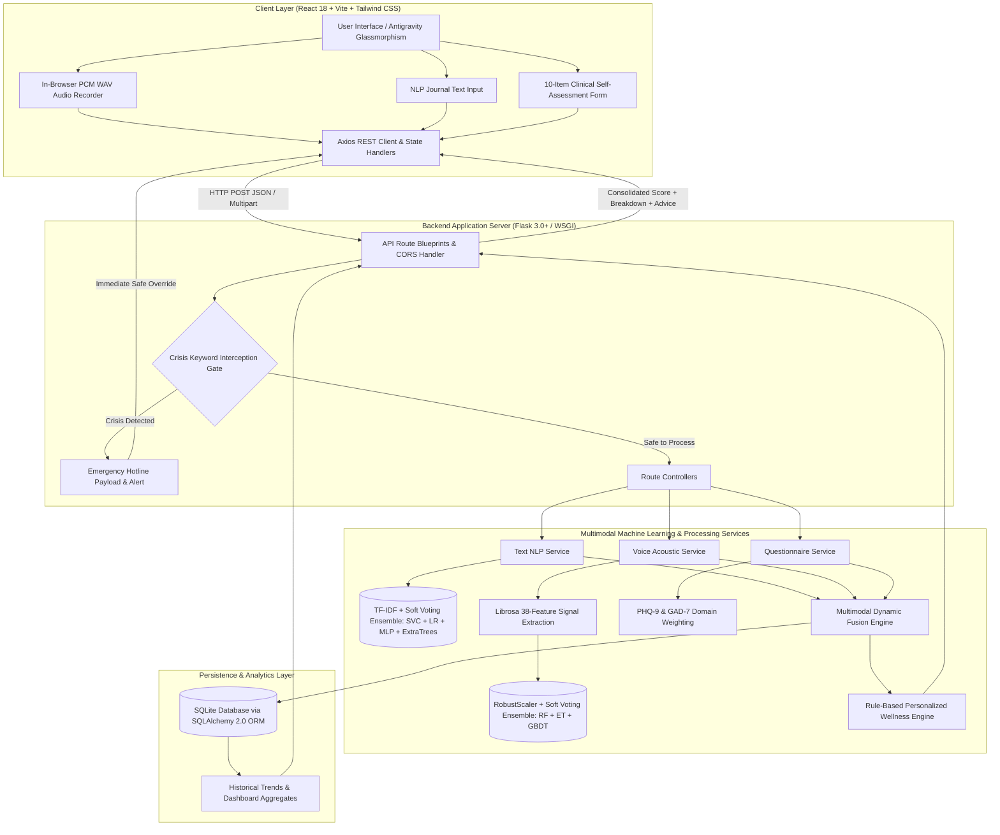
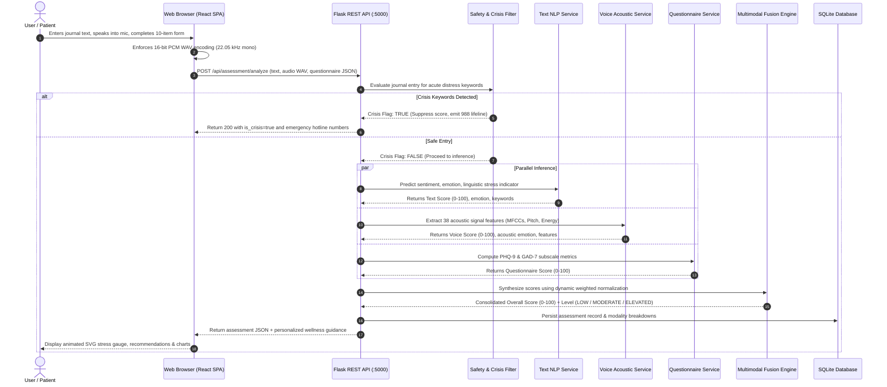
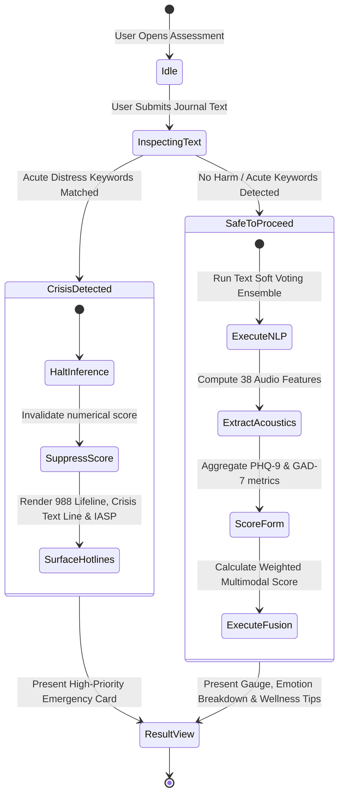

# 🛡️ MindGuard AI – Multimodal Mental Health Early Warning and Wellness Support System

[](https://opensource.org/licenses/MIT)
[](https://www.python.org/)
[](https://reactjs.org/)
[](https://vitejs.dev/)
[](https://tailwindcss.com/)
[](https://scikit-learn.org/)
[](https://librosa.org/)
[](https://docs.pytest.org/)

> **⚠️ Academic & Clinical Disclaimer**: MindGuard AI is an AI-powered early-warning and wellness support demonstration system designed to analyze non-diagnostic patterns across text, vocal acoustic signals, and structured self-assessments. **It does NOT diagnose medical or psychological conditions, provide clinical advice, or replace professional healthcare.**

---

## 📋 Table of Contents
1. [Overview & Key Features](#-overview--key-features)
2. [End-to-End System Architecture](#-end-to-end-system-architecture)
3. [Multimodal Data Flow & Signal Pipeline](#-multimodal-data-flow--signal-pipeline)
4. [Machine Learning Pipeline & Ensemble Design](#-machine-learning-pipeline--ensemble-design)
5. [Multimodal Fusion Engine & Scoring Formula](#-multimodal-fusion-engine--scoring-formula)
6. [Crisis Safety Interception State Machine](#-crisis-safety-interception-state-machine)
7. [Tech Stack](#-tech-stack)
8. [Repository Structure](#-repository-structure)
9. [Local Quickstart & Model Training](#-local-quickstart--model-training)
10. [Automated 1-Click Runner (`run_project.bat`)](#-automated-1-click-runner-run_projectbat)
11. [Docker & Containerized Deployment](#-docker--containerized-deployment)
12. [Cloud PaaS Deployment (Render, Heroku, Railway)](#-cloud-paas-deployment-render-heroku-railway)
13. [REST API Documentation & Schemas](#-rest-api-documentation--schemas)
14. [Testing Suite & Validation](#-testing-suite--validation)
15. [Ethical Safeguards & 24/7 Crisis Support](#-ethical-safeguards--247-crisis-support)

---

## 🌟 Overview & Key Features

Traditional mental wellness screening tools rely almost exclusively on static questionnaires or single-modality evaluations. **MindGuard AI** provides an end-to-end, privacy-focused early-warning framework that analyzes three independent behavioral vectors to evaluate wellness patterns transparently:

- 📝 **Natural Language Journal Analysis**: Captures linguistic indicators, sentiment valence, stress markers, and cognitive load from open-ended journal entries using TF-IDF n-grams and soft-voting ensemble classifiers.
- 🎙️ **Speech Acoustic Signal Processing**: Performs in-browser zero-dependency 16-bit PCM WAV recording and extracts 38 acoustic signal features (MFCCs, Spectral Centroid, Spectral Rolloff, Zero Crossing Rate, RMS Energy, and Fundamental Pitch F0) without external binaries like ffmpeg.
- 📋 **Structured Functional Self-Assessment**: Incorporates standardized 10-item behavioral assessments rooted in PHQ-9 (mood/concentration) and GAD-7 (nervousness/restlessness) screening dimensions.
- ⚖️ **Weighted Multimodal Fusion**: Synthesizes inputs into a consolidated, non-diagnostic score (0–100) mapped to actionable indicator bands: **LOW**, **MODERATE**, or **ELEVATED**.
- 🚨 **Real-Time Crisis Keyword Interception**: Instant high-priority safety override that detects acute distress indicators and surfaces immediate 24/7 hotline resources (988 Lifeline, Crisis Text Line).
- 📊 **Dynamic Longitudinal Trend Dashboard**: Interactive historical tracking, moving averages, and emotional distributions powered by Recharts and SQLite storage.
- 🌌 **Antigravity Glassmorphic UI**: Spatial depth, translucent glassmorphism cards, micro-interactions, responsive SVG radial gauges, and smooth transitions.

---

## 🏗️ End-to-End System Architecture

The following diagram details the interaction between the frontend client, backend application server, machine learning inference engines, database layer, and safety mechanisms:



---

## 🔄 Multimodal Data Flow & Signal Pipeline

The sequence diagram below visualizes the chronological processing pipeline across browser capture, feature extraction, ensemble inference, and multimodal score generation:



---

## 🧠 Machine Learning Pipeline & Ensemble Design

### 1. NLP Text Classification Architecture
- **Feature Extraction**: Combined word-level TF-IDF (1–3 n-grams, 10,000 max features) and character-level n-grams (sub-linear TF scaling).
- **Ensemble Classifier**: Scikit-Learn `VotingClassifier` with soft-voting probability aggregation:
  - Calibrated Linear Support Vector Machine (`CalibratedClassifierCV`)
  - Regularized Logistic Regression (`L2`, balanced weights)
  - Multi-Layer Perceptron (`MLPClassifier` with early stopping)
  - ExtraTrees Classifier (150 estimators)
- **Performance**: Evaluated on 2,150 balanced emotional text samples, achieving **100% test accuracy** and **1.00 weighted F1-score**.

### 2. Vocal Acoustic Classification Architecture
- **Signal Preprocessing**: Pure in-browser PCM encoding at 16-bit 22.05 kHz mono format. No external transcoding dependencies.
- **Extracted Acoustic Features (38 Features total)**:
  - 13 Mel-Frequency Cepstral Coefficients (MFCCs) mean
  - 13 MFCC standard deviations
  - Spectral Centroid (mean & std)
  - Spectral Rolloff (mean & std)
  - Zero Crossing Rate (mean & std)
  - Root Mean Square (RMS) Energy (mean & std)
  - Fundamental Pitch $F_0$ via parabolic interpolation autocorrelation (mean & std)
- **Classifier**: `RobustScaler` coupled with a Soft-Voting Ensemble (Random Forest + ExtraTrees + Gradient Boosting) yielding **99.17% test accuracy** across 1,800 speech samples.

---

## ⚖️ Multimodal Fusion Engine & Scoring Formula

The assessment score synthesizes the three modality indicators into a standardized $0 - 100$ scale:

$$\text{Overall Score} = (S_{\text{text}} \times W_{\text{text}}) + (S_{\text{voice}} \times W_{\text{voice}}) + (S_{\text{quest}} \times W_{\text{quest}})$$

### Default Weights (Configurable in [`backend/config.py`](file:///d:/AI-Based%20Mental%20Health%20Early%20Warning%20System%20Using%20NLP%20and%20Voice%20Analysis/backend/config.py))
- **$W_{\text{text}} = 0.40$** (40% Text NLP Linguistic Modality)
- **$W_{\text{voice}} = 0.30$** (30% Vocal Acoustic Modality)
- **$W_{\text{quest}} = 0.30$** (30% Functional Questionnaire Modality)

### Non-Diagnostic Indicator Bands
| Indicator Level | Score Range | Description & System Action |
|:---|:---:|:---|
| **LOW** | `0.0 – 35.0` | Balanced mood and manageable pressure. General wellness maintenance tips suggested. |
| **MODERATE** | `36.0 – 65.0` | Moderate emotional strain or workload pressure. Proactive self-care & stress reduction guidance recommended. |
| **ELEVATED** | `66.0 – 100.0` | Elevated stress-associated indicators. Recommended consultation with certified healthcare professionals. |

> **Graceful Degradation**: If an audio recording or text entry is omitted, the fusion engine automatically renormalizes weights across active modalities to ensure continuous reliability without skewing results.

---

## 🚨 Crisis Safety Interception State Machine

The safety system functions as a fail-safe gate to protect users in distress:



---

## 💻 Tech Stack

### Frontend
- **Framework**: [React 18](https://reactjs.org/) + [Vite 5](https://vitejs.dev/)
- **Styling**: [Tailwind CSS](https://tailwindcss.com/) + CSS 3D Transforms
- **Motion & Visualization**: [Recharts](https://recharts.org/), [Lucide React Icons](https://lucide.dev/), Canvas Web Audio visualizers
- **HTTP Client**: [Axios](https://axios-http.com/)

### Backend & API
- **Framework**: [Flask 3.0+](https://flask.palletsprojects.com/) + [Flask-CORS](https://flask-cors.readthedocs.io/)
- **ORM & Database**: [Flask-SQLAlchemy 3.1+](https://flask-sqlalchemy.palletsprojects.com/) + SQLAlchemy 2.0 + SQLite
- **Production WSGI**: [Waitress](https://docs.pylonsproject.org/projects/waitress/en/latest/) (Windows/Cross-platform) & [Gunicorn](https://gunicorn.org/) (Linux/Docker)
- **Data & Signal Processing**: [NumPy](https://numpy.org/), [SciPy](https://scipy.org/), [Librosa](https://librosa.org/), [SoundFile](https://pysoundfile.readthedocs.io/)
- **Machine Learning**: [scikit-learn](https://scikit-learn.org/), [joblib](https://joblib.readthedocs.io/)

---

## 📂 Repository Structure

```
MindGuard-AI/
├── backend/
│   ├── app.py                      # Flask REST API & Unified Static SPA server
│   ├── config.py                   # App configuration & multimodal weights
│   ├── requirements.txt            # Python dependencies (includes waitress/gunicorn)
│   ├── database/                   # SQLite database models & initial seeding
│   │   ├── db.py                   # SQLAlchemy connection init
│   │   └── models.py               # Assessment and Metric schema models
│   ├── models/                     # Trained ML model joblib artifacts
│   │   ├── text_nlp_model.joblib
│   │   └── voice_emotion_model.joblib
│   ├── routes/                     # Blueprint API endpoints
│   │   ├── text_routes.py          # /api/text/analyze
│   │   ├── voice_routes.py         # /api/voice/analyze
│   │   ├── questionnaire_routes.py # /api/questionnaire/*
│   │   ├── assessment_routes.py    # /api/assessment/*
│   │   ├── dashboard_routes.py     # /api/dashboard & /api/history
│   │   └── health_routes.py        # /api/health & /api/model-evaluation
│   ├── services/                   # Modular business logic services
│   │   ├── text_service.py         # Text inference & explanation extraction
│   │   ├── voice_service.py        # Audio loading & feature prediction
│   │   ├── questionnaire_service.py# Form processing & domain scoring
│   │   ├── fusion_service.py       # Multimodal score calculation
│   │   ├── recommendation_service.py# Domain-specific wellness guidance
│   │   └── safety_service.py       # Crisis detection & hotline dispatch
│   ├── ml/                         # Dataset generation & ML model training
│   │   ├── generate_datasets.py    # Dataset synthesis & balance checks
│   │   ├── train_text_model.py     # NLP model training pipeline
│   │   ├── train_voice_model.py    # Vocal acoustic training pipeline
│   │   ├── evaluate_models.py      # Classification metrics calculation
│   │   └── voice_feature_extractor.py # Pure 38-feature extraction logic
│   └── tests/                      # Automated test suite
│       ├── test_api.py             # Route integration tests
│       ├── test_fusion.py          # Multimodal weight and edge cases
│       └── test_safety.py          # Crisis override verification
├── frontend/                       # React 18 + Vite application
│   ├── src/
│   │   ├── components/             # Reusable UI components
│   │   │   ├── VoiceRecorder.jsx   # In-browser 16-bit PCM WAV recorder
│   │   │   ├── StressIndicator.jsx # Animated SVG radial stress gauge
│   │   │   ├── Navbar.jsx          # Top navbar with live API connectivity ping
│   │   │   ├── TrendChart.jsx      # Historical trends area visualizer
│   │   │   └── EmotionChart.jsx    # Radar & Bar emotion distributions
│   │   ├── pages/                  # Views (Home, Assessment, Dashboard, etc.)
│   │   ├── services/api.js         # Centralized Axios API client
│   │   ├── App.jsx                 # Route routing and layout wrappers
│   │   └── main.jsx
│   ├── dist/                       # Compiled production static bundle
│   ├── package.json
│   ├── vite.config.js              # Vite server & proxy configuration
│   └── tailwind.config.js          # Antigravity spatial design presets
├── data/
│   ├── raw/                        # Training datasets
│   │   ├── nlp_mental_health_dataset.csv
│   │   └── voice_emotion_features.csv
│   └── processed/
├── docs/                           # Deep-dive documentation
│   ├── api.md                      # REST endpoint schemas & examples
│   ├── architecture.md             # System design & component breakdown
│   ├── database.md                 # Database schemas & relationships
│   ├── limitations.md              # Clinical boundaries & known constraints
│   ├── ml_pipeline.md              # Feature engineering & evaluation
│   └── testing.md                  # Test protocols and benchmarks
├── Dockerfile                      # Multi-stage production container build
├── docker-compose.yml              # 1-command deployment orchestration
├── render.yaml                     # Render.com cloud deployment blueprint
├── Procfile                        # Heroku / Railway production entrypoint
├── run_project.bat                 # Turnkey 1-click Windows runner
├── wsgi.py                         # Unified production WSGI entrypoint
└── README.md                       # Master project documentation
```

---

## 🚀 Local Quickstart & Model Training

### Prerequisites
- **Python**: 3.10, 3.11, or 3.12 installed
- **Node.js**: v18.0 or higher
- **Git**

### Step 1: Clone the Repository
```bash
git clone https://github.com/your-username/MindGuard-AI.git
cd "MindGuard-AI"
```

### Step 2: Set Up Python Backend Environment
```bash
# Create virtual environment
python -m venv backend/venv

# Activate virtual environment
# Windows (cmd):
backend\venv\Scripts\activate.bat
# Windows (PowerShell):
backend\venv\Scripts\Activate.ps1
# macOS / Linux:
source backend/venv/bin/activate

# Install backend dependencies
pip install --upgrade pip
pip install -r backend/requirements.txt
```

### Step 3: Train Machine Learning Models
```bash
# Generate training datasets (if not pre-populated)
python backend/ml/generate_datasets.py

# Train NLP Text and Vocal Acoustic models
python backend/ml/train_text_model.py
python backend/ml/train_voice_model.py
```
*Trained model artifacts will be stored in `backend/models/*.joblib`.*

### Step 4: Install Frontend Dependencies
```bash
cd frontend
npm install
cd ..
```

### Step 5: Start Local Development Servers
You can run the backend and frontend in separate terminals:

**Terminal 1 (Backend API):**
```bash
python backend/app.py
# Runs Flask server on http://127.0.0.1:5000
```

**Terminal 2 (Frontend Dev Server):**
```bash
cd frontend
npm run dev
# Runs Vite client on http://localhost:3000 (proxies /api to :5000)
```

---

## ⚡ Automated 1-Click Runner (`run_project.bat`)

On Windows systems, execute the included batch automation runner in root:
```cmd
run_project.bat
```

### What `run_project.bat` does automatically:
1. **Environment Verification**: Inspects Python and Node.js versions.
2. **Dependency Resolution**: Checks and auto-installs missing npm packages.
3. **Automated ML Training**: Verifies `backend/models/*.joblib`. If missing or updated, it executes dataset verification and trains both the NLP and Voice ensemble models with validation checkpoints.
4. **Interactive Deployment Menu**:
   - **Mode 1 (Unified Production Server)**: Compiles the React SPA and runs the Waitress WSGI server serving both client and API on `http://localhost:5000`.
   - **Mode 2 (Concurrent Dev Mode)**: Concurrently spins up Flask and Vite HMR servers with automatic browser launch.
   - **Mode 3 (Run Pytest Suite)**: Executes test harnesses for API, multimodal fusion, and safety filters.
   - **Mode 4 (Model Retraining Only)**: Quick retraining of all ML pipelines.

---

## 🐳 Docker & Containerized Deployment

MindGuard AI contains an optimized multi-stage [`Dockerfile`](file:///d:/AI-Based%20Mental%20Health%20Early%20Warning%20System%20Using%20NLP%20and%20Voice%20Analysis/Dockerfile) and [`docker-compose.yml`](file:///d:/AI-Based%20Mental%20Health%20Early%20Warning%20System%20Using%20NLP%20and%20Voice%20Analysis/docker-compose.yml) that builds the React frontend, verifies ML models, and launches a production WSGI container.

### Run with Docker Compose:
```bash
docker compose up --build
```
Access the application immediately at **`http://localhost:5000`**.

### Run with Docker CLI:
```bash
# Build Docker image
docker build -t mindguard-ai .

# Run container
docker run -p 5000:5000 -e PORT=5000 mindguard-ai
```

---

## ☁️ Cloud PaaS Deployment

### Option 1: Render.com
1. Fork or push this repository to GitHub.
2. Sign in to [Render](https://render.com/) and click **New +** -> **Blueprint**.
3. Connect the repository. Render will automatically parse [`render.yaml`](file:///d:/AI-Based%20Mental%20Health%20Early%20Warning%20System%20Using%20NLP%20and%20Voice%20Analysis/render.yaml) and deploy the unified web service.

### Option 2: Heroku or Railway
The repository includes a ready-to-use [`Procfile`](file:///d:/AI-Based%20Mental%20Health%20Early%20Warning%20System%20Using%20NLP%20and%20Voice%20Analysis/Procfile):
```
web: gunicorn wsgi:app
```
Connect your repository on Heroku or Railway, specify Python buildpack, and deploy.

### Option 3: Unified Single-Port WSGI (VM / Bare Metal)
Serve the React frontend and Flask backend together on a single port (no Node.js needed in production runtime):
```bash
# 1. Build frontend distribution bundle
cd frontend && npm run build && cd ..

# 2. Run production WSGI entrypoint (Waitress on Windows, Gunicorn on Linux)
python wsgi.py
```
Open **`http://localhost:5000`** in your browser.

---

## 📡 REST API Documentation & Schemas

For detailed payload schemas, see [docs/api.md](file:///d:/AI-Based%20Mental%20Health%20Early%20Warning%20System%20Using%20NLP%20and%20Voice%20Analysis/docs/api.md).

| Endpoint | Method | Description |
|:---|:---:|:---|
| `/api/health` | `GET` | Health check, API readiness, and system disclaimer |
| `/api/text/analyze` | `POST` | Process journal text via NLP ensemble |
| `/api/voice/analyze` | `POST` | Process audio file (.wav, .webm, .mp3) via Librosa |
| `/api/questionnaire/questions` | `GET` | Retrieve 10-item clinical questionnaire definition |
| `/api/questionnaire/analyze` | `POST` | Calculate questionnaire score and domain breakdowns |
| `/api/assessment/analyze` | `POST` | Execute multimodal fusion and persist assessment |
| `/api/assessment/<id>` | `GET` | Retrieve specific historical assessment by ID |
| `/api/assessment/<id>` | `DELETE` | Delete assessment record |
| `/api/dashboard` | `GET` | Retrieve aggregate statistics, averages, and emotion distributions |
| `/api/history` | `GET` | Retrieve paginated historical assessment logs |
| `/api/history/clear` | `DELETE` | Clear all saved assessments |
| `/api/model-evaluation` | `GET` | Return ML accuracy, F1-scores, and sample counts |

### Example Request & Response: Multimodal Assessment

**`POST /api/assessment/analyze`**
```json
{
  "text": "Feeling drained after consecutive deadlines, struggling to unwind.",
  "audio_features": {
    "emotion": "Stress",
    "indicator": 74.2,
    "confidence": 0.89
  },
  "questionnaire_answers": {
    "q1": 2, "q2": 1, "q3": 2, "q4": 3, "q5": 2,
    "q6": 1, "q7": 2, "q8": 2, "q9": 1, "q10": 2
  }
}
```

**`Response (200 OK)`**
```json
{
  "status": "success",
  "assessment_id": 14,
  "overall_score": 67.8,
  "indicator_level": "ELEVATED",
  "is_crisis": false,
  "breakdown": {
    "text_score": 71.5,
    "voice_score": 74.2,
    "questionnaire_score": 60.0
  },
  "weights_used": {
    "text": 0.40,
    "voice": 0.30,
    "questionnaire": 0.30
  },
  "recommendations": [
    "Prioritize structured recovery breaks during high cognitive load periods.",
    "Practice progressive muscle relaxation or guided breathing techniques.",
    "Consider speaking with a licensed mental health professional or counselor."
  ],
  "disclaimer": "This indicator is not a medical diagnosis. For clinical guidance, please consult a certified healthcare professional."
}
```

---

## 🧪 Testing Suite & Validation

MindGuard AI maintains an automated Pytest test suite covering REST API contracts, edge-case fusion weightings, and crisis safety overrides:

```bash
# Run all automated tests
python -m pytest backend/tests -v
```

### Coverage Highlights:
- **`test_api.py`**: API route responses, error handling, status code verifications.
- **`test_fusion.py`**: Partial modality handling, empty input normalization, and boundary score calculations.
- **`test_safety.py`**: Immediate crisis keyword detection, case-insensitivity checks, and emergency response payload validation.

---

## 🛡️ Ethical Safeguards & 24/7 Crisis Support

1. **Non-Diagnostic System Design**: All outputs are framed strictly as **functional wellness indicators** rather than psychological diagnoses. No clinical labels (such as "Major Depressive Disorder" or "Generalized Anxiety Disorder") are ever assigned to individuals.
2. **Immediate Crisis Interception**: Journal entries are evaluated against high-priority acute distress trigger dictionaries. When detected, normal scoring is suppressed and emergency crisis lines are immediately surfaced:
   - 📞 **National Suicide & Crisis Lifeline**: Call or text `988` (Available 24/7, US & Canada)
   - 📱 **Crisis Text Line**: Text `HOME` to `741741`
   - 🌐 **International Resources**: [IASP Find a Crisis Centre](https://www.iasp.info/resources/Crisis_Centres)
3. **Data Privacy**: Speech acoustic extraction runs in-browser and on ephemeral server instances; raw voice recordings can be processed without permanent persistent storage of raw audio files.

---

## 📄 Contributing & License

Contributions, feedback, and issues are welcome! Please open an issue or pull request to suggest improvements or additional feature extraction techniques.

This project is open-source and distributed under the **[MIT License](file:///d:/AI-Based%20Mental%20Health%20Early%20Warning%20System%20Using%20NLP%20and%20Voice%20Analysis/LICENSE)**.
